### `chriis@github ~ $ ./contributions.sh`

### `chriis@github ~ $ whoami`

 

### `chriis@github ~ $ ls mes-codes/`

**[IDATE](https://github.com/CHRIISHEART/IDATE)** · drop soon &nbsp;&nbsp;|&nbsp;&nbsp; **[idsherlock](https://github.com/CHRIISHEART/idsherlock)** · drop soon

Étudiant · Martinique 🇲🇶

