<!-- Cartes SVG animées générées par scripts/render_readme_cards.py.
     Garder ce bloc sans lignes vides, et les cartes d'une même rangée sur une seule ligne sans espaces. -->

 
 
 
 
<picture><source media="(prefers-color-scheme: dark)" srcset="./cards/title-coding-dark.svg" /></picture> 

